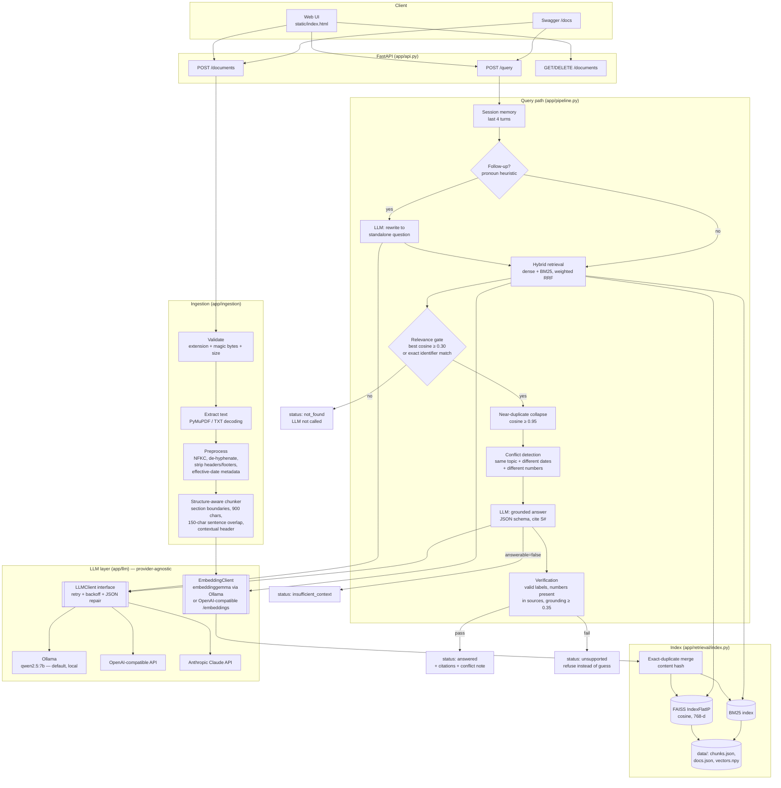

# Architecture — Document RAG Q&A

## Pipeline overview



## Components

| Module | Responsibility |
|---|---|
| `app/api.py` | HTTP layer: upload (per-file results, one bad file never fails the batch), query, document management, error → status code mapping |
| `app/pipeline.py` | Orchestrates ingestion and the query path, records per-stage timings |
| `app/ingestion/loaders.py` | File-type detection from extension **and** content (magic bytes), PDF/TXT extraction, corrupt/encrypted/scanned detection |
| `app/ingestion/cleaner.py` | Unicode normalisation, de-hyphenation, running header/footer removal, effective-date extraction |
| `app/ingestion/chunker.py` | Structure-aware recursive chunking with sentence overlap and contextual chunk headers |
| `app/retrieval/index.py` | FAISS + BM25 index, exact-duplicate merging, persistence |
| `app/retrieval/retriever.py` | Dense / BM25 / hybrid (weighted RRF) retrieval, relevance gate, near-duplicate collapse |
| `app/generation/conversation.py` | Session store (TTL), follow-up detection, query rewriting |
| `app/generation/conflicts.py` | Deterministic detection of conflicting chunks from differently dated documents |
| `app/generation/answerer.py` | Grounded generation with structured output, citation validation, grounding check, conflict handling |
| `app/llm/` | Provider-agnostic `LLMClient` (Ollama / OpenAI-compatible / Anthropic) and `EmbeddingClient` |

## LLM API layer

All model calls go through `LLMClient.chat()` / `chat_json()`:

* **retries with exponential backoff** for transient errors; no retry when the server is unreachable (fails fast with HTTP 503);
* **structured output**: the JSON schema comes from the Pydantic model. Ollama enforces it with constrained decoding (`format=schema`), and the other providers get the schema as an instruction;
* **validation + one repair round**: if the reply isn't valid JSON or fails Pydantic validation, the error is sent back to the model once, and after that `LLMOutputError` is raised (HTTP 502);
* **deterministic settings**: `temperature=0` and a fixed `seed`.

Switching from the local model to a hosted API is a configuration change:

```bash
LLM_PROVIDER=openai     LLM_MODEL=gpt-4o-mini  LLM_BASE_URL=https://api.openai.com/v1  LLM_API_KEY=...
LLM_PROVIDER=anthropic  LLM_MODEL=claude-opus-5-5   # uses ANTHROPIC_API_KEY
```

## Data flow for one query

1. If the session has history and the question refers back ("it", "that", "what about…"), the LLM rewrites it into a standalone question.
2. The query is embedded (EmbeddingGemma query prompt). FAISS returns the top 20 by cosine and BM25 returns the top 20 lexical matches. They are fused with weighted reciprocal rank fusion.
3. **Relevance gate**: if the best cosine is under 0.30 and no identifier (an error code, model number or email) matches exactly, the system answers `not_found` **without calling the LLM**. Otherwise it keeps chunks scoring at least 75% of the best score, collapses near-duplicates, and caps the result at top-5.
4. **Conflict detection**: chunks from documents with different effective dates that cover the same topic and contain different numbers are flagged. The newer one is put first and the older one is marked as outdated.
5. The LLM produces `{answerable, answer, cited_sources, conflict_note}`.
6. **Verification**: cited labels must exist, every number in the answer must appear in a cited source, and the share of answer content words found in the cited sources must be at least 0.35. Any failure becomes `unsupported` and the system refuses rather than guess. If the model cited only an outdated source, the answer is regenerated without it.
7. The turn is stored in the session. Only the standalone question is shown to the generator; earlier answers are not.
