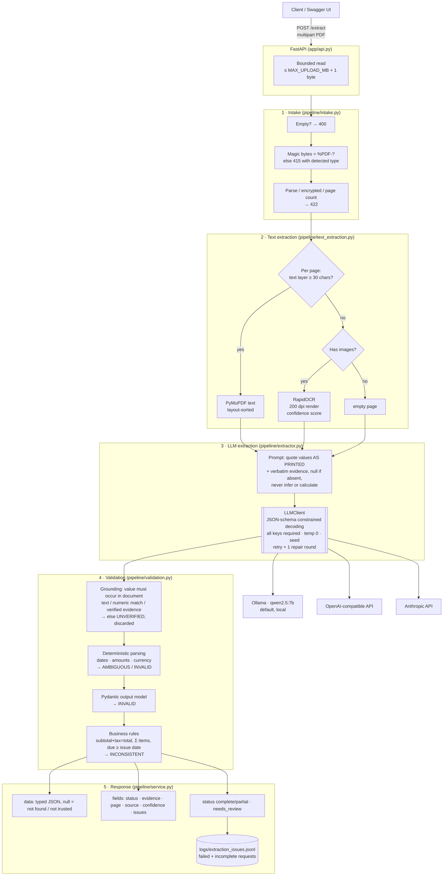

# Architecture — Document Understanding & Structured Extraction

## Processing pipeline

## Separation of responsibilities

| Stage | Module | Decides | Never does |
|---|---|---|---|
| Intake | `pipeline/intake.py` | Is this a usable PDF? (size, magic bytes, encryption, page count) | Reads content |
| Text extraction | `pipeline/text_extraction.py` | Text layer or OCR, per page | Interprets meaning |
| LLM extraction | `pipeline/extractor.py` + `doc_types/invoice.py` prompt | *Where* each value is printed (raw string + evidence) | Converts formats, calculates, validates |
| Validation | `pipeline/validation.py`, `pipeline/normalize.py`, `doc_types/invoice.py` rules | Whether a value is real, parseable, schema-valid and consistent | Calls the LLM |
| Response | `pipeline/service.py`, `schemas.py` | Overall status, `needs_review`, logging | Changes values |

The key design choice is that **the LLM locates and code decides**. Parsing "03/04/2024", "1.234,56" or "Rs. 1,29,800.00" is deterministic code, which can *detect* ambiguity. An LLM silently resolves it one way or the other.

## Field status model

| Status | Meaning | In `data` |
|---|---|---|
| `extracted` | Found in the document text, parsed, schema-valid, consistent | value |
| `not_found` | Not printed in the document | `null` |
| `ambiguous` | Printed, but has several valid readings (candidates listed) | `null` |
| `invalid` | Printed, but unparseable or fails the schema | `null` |
| `unverified` | The model returned a value that isn't in the document, so it's discarded as a hallucination | `null` |
| `inconsistent` | Parsed, but contradicts another field (the rule is shown) | value, flagged |

`status = complete` only when all required fields (`invoice_number`, `invoice_date`, `vendor_name`, `total_amount`, `currency`) are `extracted`. Otherwise it's `partial`. `needs_review` is also raised by ambiguous, invalid, unverified or inconsistent fields, error-level rule violations, and low OCR confidence.

## API

| Method | Path | Purpose |
|---|---|---|
| `POST` | `/extract?document_type=invoice` | Upload a PDF and get an `ExtractionResponse` |
| `GET` | `/document-types` | Supported types, required fields and the JSON schema of each output |
| `GET` | `/health` | Model, limits, OCR status |
| `GET` | `/docs`, `/openapi.json` | Swagger UI / OpenAPI spec |

Status codes: `200` (complete or partial; partial is still a successful extraction, with uncertainty reported in the body), `400` empty file / unknown type, `413` too large, `415` not a PDF, `422` corrupt / encrypted / too many pages / no text, `502` LLM output failed the schema after repair, `503` LLM unavailable.

## Extending to new document types

`doc_types/base.py` defines the plug-in contract (`DocumentType`): the raw LLM schema, the typed output model, field kinds, required fields, a prompt and business rules. Adding resumes means writing `doc_types/resume.py` and registering it in `doc_types/__init__.py`. Intake, OCR, grounding, parsing, the API and logging are shared. For mixed uploads, a classification step (keywords plus a small LLM call) could choose the type automatically.
