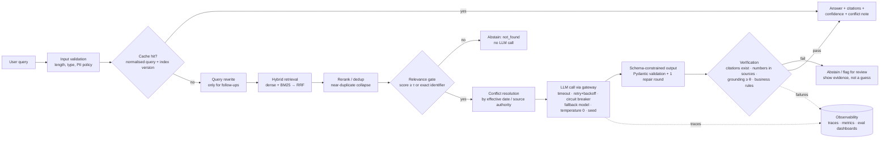

# Think Like a GenAI Engineer: making an LLM application reliable

**Scenario.** An LLM application answers user questions using external information. In testing we observe five symptoms:

* **S1** confident but incorrect answers
* **S2** irrelevant retrieved information
* **S3** unexpected output formats
* **S4** external APIs failing or responding slowly
* **S5** the same query producing different results

**Core idea.** Treat the LLM as an unreliable component inside a reliable system. Each step the model performs gets a deterministic check before or after it, and any failure resolves to a defined, honest outcome rather than a guess.

The examples below come from the two systems built for this assessment (`ps1-rag-qa`, `ps5-doc-extraction`). Each symptom above showed up in them and was fixed.

---

## 1. Root causes

| Symptom | Likely root causes | Seen in this assessment |
|---|---|---|
| **S1 Confident wrong answers** | (a) The retrieved context doesn't contain the answer and the model fills the gap from priors. (b) The context contains **conflicting or outdated** passages and the model picks the wrong one. (c) The model mis-reads the right passage, such as numbers, units or entities (RX-200 vs RX-300). (d) Prompt pressure to always answer. (e) Conversation history leaks an earlier wrong answer into a new one. | (b) The 7B model answered from a 2024 handbook superseded by a 2025 policy. (e) The model answered a follow-up from its own previous answer instead of the sources. |
| **S2 Irrelevant retrieval** | Chunks that mix topics (fixed-size windows across sections). Embedding/query mismatch: typos, rare identifiers like `E204`, missing query/document task prompts. Lexical overlap bias (BM25 over-weighting a repeated product name). Follow-up questions retrieved without resolving "it". No relevance threshold, so top-k always returns *something*. Duplicate chunks crowding out other evidence. | BM25 ranked the warranty chunk first for "battery runtime" because "RX-200" appears in it more often. BM25 found nothing for "pasword lenght". |
| **S3 Unexpected format** | Free-text prompting instead of schema-constrained decoding. Optional schema fields, which the model silently omits. Prose or markdown fences around JSON. Labels in an unexpected shape (`"[S2]"` vs `"S2"`). Output truncated at `max_tokens`. | Ollama's constrained decoding *omitted* fields that had defaults, so 10 of 14 invoice fields came back missing. Fixed by making every field required. |
| **S4 API failures/slowness** | Transient 5xx and 429 errors, cold model loads, network latency, no timeouts, no retries (or retries without backoff), resource contention, long prompts. | On a 4 GB GPU, the embedding model and the LLM evicted each other (+6 s per query). `localhost` resolving to IPv6 first added ~2 s per HTTP call on Windows. |
| **S5 Non-determinism** | Sampling temperature above 0. No fixed seed. Non-deterministic batching on the server. Retrieval ties broken arbitrarily. Index changes between runs. Model version drift behind an alias. Prompt changes that aren't versioned. | |

## 2. Investigating and debugging

1. **Reproduce and localise, stage by stage.** Log one trace per request: the original question, the rewritten question, the retrieved chunk IDs and scores, the full prompt, the raw model output, the parsed output, the validation results, and per-stage timings. Every symptom then becomes a question about one stage. For example, *was the answer-bearing chunk retrieved at all?* If not, it's a retrieval problem. If it was retrieved and the answer is still wrong, it's a generation problem.
2. **Build a labelled evaluation set early.** Include answerable questions with an evidence string, unanswerable and near-topic traps, typos, follow-ups, and conflicting or duplicate documents. Run it on every change.
3. **Measure each stage separately.** Retrieval gets Hit@k and MRR per mode. Generation gets answer correctness, citation correctness and a grounding score. Refusals get precision on the unanswerable set. Latency is measured per stage.
4. **Inspect the failures, not just the averages.** Every fix in Project 1 came from reading individual failed rows. For example, the "unsupported" rejections turned out to be the verifier reading "200" from "RX-200" as an unsupported number.
5. **Run ablations.** Turn one component on or off at a time (dense vs BM25 vs hybrid, with or without history in the prompt, BM25 weight 1.0 / 0.5 / 0.3) to find what actually helps.
6. **For S5,** run the same input N times at temperature 0 with a fixed seed. If results still differ, diff the retrieved IDs (a retrieval tie or index change) against the prompts (an unversioned prompt) against the model version.
7. **For S4,** compare client-side timings with server-reported durations (Ollama returns `load_duration` and `total_duration`). That separated model load from connection overhead and revealed the IPv6 delay.

## 3. Proposed architecture

The four layers each take one symptom.

| Layer | What it does | Fixes |
|---|---|---|
| **Retrieval quality** | Structure-aware chunking, asymmetric embedding prompts, hybrid retrieval with a down-weighted lexical branch, dedup, relevance gate, an identifier override for codes | S2, and S1(a) |
| **Constrained generation** | Schema-constrained decoding, required fields, temperature 0 with a fixed seed, a prompt that allows "not answerable", newer sources first with older ones labelled outdated | S3, S5, S1(b, d) |
| **Deterministic verification** | Citation labels must exist; every number must appear in a cited source; lexical grounding threshold; cross-field business rules (subtotal + tax = total); for extraction, every value must be found verbatim in the document | S1(a, c) |
| **Resilient I/O** | A gateway around every external call: timeouts, bounded retries with exponential backoff (none when the server is unreachable), a circuit breaker, fallback model or provider, persistent connections, caching, async jobs for long work | S4 |

## 4. Validating accuracy and reliability

* **Offline evaluation set, versioned with the code.** Answerable / unanswerable / near-topic / typo / follow-up / conflict cases for RAG, and per-field ground truth for extraction. Metrics:
  * retrieval: Hit@k and MRR;
  * answers: correct, cited the expected source, grounding score, refusal precision and recall;
  * extraction: field accuracy split into **missed / wrong / hallucinated**. These failures have very different costs; a hallucinated invoice total is far worse than a missing one.
* **Regression tests with a fake LLM** for every failure found (90 tests across both projects, each suite runs in about a second). They pin the *deterministic* behaviour around the model: what happens when it invents a citation, returns bad JSON, cites an outdated source, or the API is down.
* **Consistency tests.** Run each evaluation query N times and report the agreement rate. That turns S5 into a metric.
* **Fault injection.** A fake provider that times out, returns 500, returns malformed JSON or refuses; assert the documented status codes and fallbacks.
* **Online:** log a sample of production traces, track abstention rate, verification-failure rate, latency percentiles and user feedback, and periodically review a sample of the logs by hand or with an LLM judge. Hold out a test split so tuned thresholds (gate τ, BM25 weight) aren't scored on the data they were tuned on.

## 5. Which technique solves which problem

| Problem | Prompt engineering | Application logic | Retrieval improvements | Model selection | Other |
|---|---|---|---|---|---|
| S1 confident wrong answers | Allow and encourage "not answerable"; require citations | **Verification** (citations, numbers, grounding); **conflict resolution in code**; history only for rewriting | Relevance gate; better chunks so the right passage is in context | Stronger model reads context more faithfully | Human review for low-confidence answers |
| S2 irrelevant retrieval | (Only the query rewrite prompt) | Gate, dedup, identifier override | **Chunking, embedding choice, hybrid + RRF, reranking, metadata filters** | Better embedding model | Evaluation set to measure it |
| S3 format | Show the schema and an example | **Pydantic validation + repair round**, label normalisation | | Models with native structured output | **Constrained decoding**, required fields |
| S4 API failures | Shorter prompts reduce latency | **Timeouts, retries/backoff, circuit breaker, fallback, caching, async queue** | Fewer, better chunks mean a shorter prompt | Smaller or faster model for simple routes | Infrastructure: keep-alive, co-location, GPU sizing |
| S5 non-determinism | Versioned prompts | Deterministic tie-breaking, caching by (query, index version) | Stable index snapshots | Pin exact model versions | temperature 0 + seed; consistency tests |

**Rule of thumb from this assessment:** anything that *can* be checked deterministically should not be left to the prompt. "Prefer the newest source" in the prompt was ignored by the model, while the same rule in code worked every time. Prompts express intent; application logic enforces it.

## 6. When the system cannot answer confidently

The system should *say less, not guess more*, and say why.

1. **Abstain explicitly with a typed status** instead of a fluent guess:
   * `not_found`: nothing relevant was retrieved;
   * `insufficient_context`: related passages exist but don't answer the question;
   * `unsupported`: the draft failed verification;
   * for extraction, per field: `not_found`, `ambiguous` (with candidates), `unverified` (discarded) or `inconsistent`.
2. **Show the evidence it does have**, such as the closest passages or the two candidate dates for `03/04/2024`, so a person can decide quickly.
3. **Answer the supported part** and state what's missing, rather than all-or-nothing.
4. **Escalate**: set `needs_review = true`, route to a person, and log the case to the failure log (`extraction_issues.jsonl`). These cases become new evaluation examples.
5. **Degrade gracefully on infrastructure failure.** Return 503 with a clear message (or fall back to another model) instead of an empty or partial answer that looks complete.

## 7. Trade-offs: accuracy, latency, cost, complexity

| Technique | Accuracy | Latency | Cost | Complexity | When it's worth it |
|---|---|---|---|---|---|
| Deterministic verification (citations, numbers, rules) | ++ (blocks the worst errors) | ≈0 ms | free | low | **Always**: the best value of anything here |
| Relevance gate before the LLM | + | **saves** a full generation on off-topic queries | **saves** | low | Always; needs calibration on data |
| Hybrid retrieval + RRF | + (robust to typos and codes) | +ms | free | low | Default |
| Cross-encoder reranker | ++ | +100–300 ms | small | medium | Large corpora, high precision needs |
| Query rewriting for follow-ups | + for multi-turn | +1 LLM call (5–7 s locally) | +1 call | low | Only when the question refers back (heuristic) |
| LLM self-check / judge per answer | + | ×2 latency | ×2 cost | medium | High-stakes answers, or offline evaluation only |
| Bigger or hosted model | ++ | −/+ (faster on hosted GPUs, plus network) | $$ per token; data leaves the machine | low | When local quality or latency isn't enough and data policy allows |
| Retries + fallback model | + availability | worst case grows (bounded by timeouts) | + on failures | medium | Any production system |
| Caching | 0 | −− on hits | −− | low–medium (invalidate on index or prompt change) | Repeated questions |
| OCR for scanned documents | enables a whole input class | +10–20 s per page | CPU | medium | Only for pages with no text layer (per-page decision) |

**Default position:** add cheap deterministic safeguards first, then add model capacity only where the evaluation shows a measured gap. In Project 1, deterministic fixes alone took end-to-end accuracy on the evaluation set from 13/16 to 16/16 without changing the model. The remaining cost is latency, which is a hardware or hosting decision, not a design flaw.
